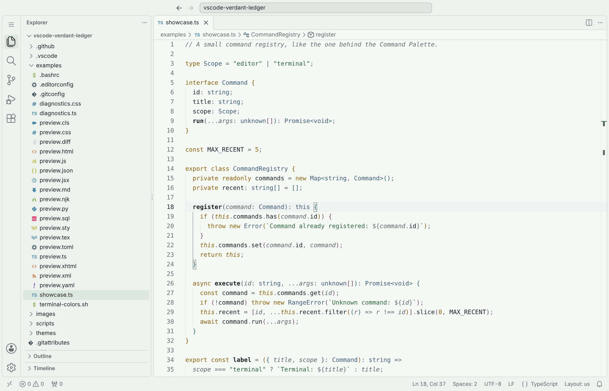
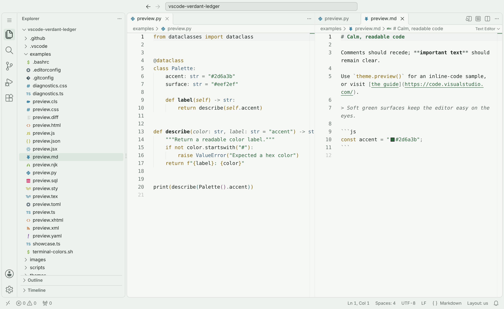

# Verdant Ledger Light

A calm, low-glare light theme for Visual Studio Code. Soft green-tinted
surfaces, deep evergreen text, and a small set of muted accents keep code
legible through long editing sessions without a crowd of competing colors.

**Website:** [nelvaron.github.io/vscode-verdant-ledger](https://nelvaron.github.io/vscode-verdant-ledger/)



## Highlights

- **Calm by design.** Most code is deep evergreen and gray-green. Color is
  reserved for what carries meaning: ochre for keywords, forest green for
  strings, slate blue for types.
- **Readable for everyone.** Syntax colors and interface text meet WCAG AA
  contrast (4.5:1). The error red is darker than the warning ochre so the two
  stay distinct with red-green color blindness.
- **Complete.** Covers the editor, sidebars, diff and merge views, debugging,
  testing, notebooks, Source Control graph, chat, and all 16 terminal colors,
  so VS Code's default blues never show through.
- **Semantic highlighting.** Language servers such as TypeScript and Pylance
  refine the colors: declarations are bold, deprecated symbols are struck
  through, and `this` and `self` stand out.
- **Checked automatically.** Every change is validated for contrast, palette
  use, and color keys that VS Code knows.

## Install

1. Open the Extensions view (**Ctrl+Shift+X**, or **Cmd+Shift+X** on macOS).
2. Search for **Verdant Ledger Light** and select **Install**.
3. Open the Command Palette (**Ctrl+Shift+P**), run **Preferences: Color
   Theme**, and choose **Verdant Ledger Light**.

The theme is also available on [Open VSX](https://open-vsx.org/extension/nelvaron/verdant-ledger-light)
for VSCodium, Cursor, Windsurf, Gitpod, and other editors that use it.

A matching browser theme for Chrome, Edge, and other Chromium browsers is in
the [Chrome Web Store](https://chromewebstore.google.com/detail/kpbfkockcbnoncanamgcnbfkiffannln)
([source](https://github.com/nelvaron/chromium-verdant-ledger)).



## Color palette

| Color | Name | Used for |
| --- | --- | --- |
| `#1b2320` | Deep evergreen | Text, variables, functions |
| `#5d6864` | Evergreen gray | Secondary text, parameters, JSON and YAML keys, operators |
| `#66716d` | Muted gray-green | Comments, punctuation, line numbers |
| `#2d6a3b` | Forest green | Accent, strings, markup tags, success |
| `#8a6408` | Accessible ochre | Keywords, numbers, attributes, warnings |
| `#b8860b` | Warm ochre | Larger indicators: modified files, warning badges |
| `#3d5f7a` | Slate blue | Types, classes, interfaces, information |
| `#2f6b6b` | Muted teal | Second bracket level, graphs |
| `#7a4a6e` | Plum | Third bracket level, graphs |
| `#8a2621` | Deep brick red | Errors and deleted content |
| `#cfd6d2` | Border gray-green | Borders and separators |
| `#eef2ef` | Pale surface | Sidebars, tabs, status bar |
| `#f6f8f6` | Near-white surface | Editor, panel, and terminal background |
| `#ffffff` | White | Menus, suggestions, inputs, and other floating widgets |

[DESIGN.md](DESIGN.md) explains the roles in detail and lists the derived
tints used for selections, hovers, and the terminal colors.

## Syntax colors

| Syntax role | Color treatment |
| --- | --- |
| Comments | Muted gray-green, italic |
| Keywords and control flow | Accessible ochre |
| Word operators (`new`, `typeof`, `and`, `in`) | Accessible ochre |
| Symbolic operators (`=`, `=>`, `+`, `&&`) | Evergreen gray |
| Strings | Forest green |
| Numbers, booleans, constants | Accessible ochre |
| Types, classes, interfaces, built-in types | Slate blue |
| Function and method declarations | Deep evergreen, bold |
| Function calls and variables | Deep evergreen |
| Parameters | Evergreen gray, italic |
| `this`, `self`, `super`, `cls` | Accessible ochre, italic |
| Decorators | Accessible ochre |
| Markup tags (HTML, XML, JSX) and CSS selectors | Forest green |
| Attribute names | Accessible ochre |
| JSON and YAML keys | Evergreen gray |
| Punctuation | Muted gray-green |
| Bracket pairs (levels 1–3) | Accessible ochre, muted teal, plum |
| Markdown headings | Forest green, bold |
| Markdown inline code | Accessible ochre |
| Markdown quotes | Evergreen gray, italic |
| Deprecated symbols | Strikethrough |
| Inserted and deleted diff lines | Forest green and deep brick red |

## Accessibility

- Syntax colors reach at least 4.5:1 on the editor background and on the
  current line, and at least 3.5:1 while a selection, find match, or diff
  highlight sits behind them.
- Interface text reaches 4.5:1. Input, dropdown, and checkbox borders,
  icons, and indicators reach 3:1.
- Selected, hovered, and keyboard-focused list items look different, and
  keyboard focus is also shown with an outline.
- The current find match has an outline as well as a fill.
- Normal terminal colors reach 7:1 and bright ones 4.5:1, so each bright
  color is clearly lighter than its normal pair; only "bright white", the
  lightest gray, is paler (3:1). See
  [Bright white in the terminal](#bright-white-in-the-terminal).
- Errors, warnings, and additions differ in lightness as well as hue, so they
  remain distinguishable with deuteranopia and protanopia.

[ACCESSIBILITY.md](ACCESSIBILITY.md) lists what is tested, the known barriers,
and how to report a new one.

### Turn off italics

Comments, parameters, and `this`/`self` are italic. If your font has no true
italic, or you find italics harder to read, add this to your user settings:

```jsonc
"editor.tokenColorCustomizations": {
  "[Verdant Ledger Light]": {
    "textMateRules": [
      {
        "scope": [
          "comment",
          "punctuation.definition.comment",
          "variable.parameter",
          "variable.language",
          "markup.quote"
        ],
        "settings": { "fontStyle": "" }
      }
    ]
  }
},
"editor.semanticTokenColorCustomizations": {
  "[Verdant Ledger Light]": {
    "rules": {
      "parameter": { "italic": false },
      "selfParameter": { "italic": false },
      "clsParameter": { "italic": false }
    }
  }
}
```

### Bright white in the terminal

VS Code darkens terminal text that has less than 4.5:1 contrast
(`terminal.integrated.minimumContrastRatio`). Bright white is intentionally
paler, at 3.35:1, so with the default setting VS Code draws it at about 4.5:1,
close to white and bright black. To see the theme's bright white, lower the
setting:

```jsonc
"terminal.integrated.minimumContrastRatio": 1
```

The setting applies to all terminal text, so VS Code then no longer raises the
contrast of colors that programs choose for themselves. The theme's own colors
need no adjustment: every other one reaches 4.5:1.

## Language support

The theme colors any language that VS Code or an extension provides a grammar
for. It has been checked with TypeScript, JavaScript, JSX, Python, HTML,
XHTML, XML, CSS, JSON, YAML, TOML, SQL, Markdown, Nunjucks, LaTeX, shell,
EditorConfig, Git config, and Git diffs. YAML, Nunjucks, and LaTeX need a
language extension such as YAML by Red Hat or LaTeX Workshop.

## Contributing

Bug reports and suggestions are welcome in the
[issue tracker](https://github.com/nelvaron/vscode-verdant-ledger/issues).
[CONTRIBUTING.md](CONTRIBUTING.md) explains how to preview, validate, and
package the theme.

## License

[MIT](LICENSE)
